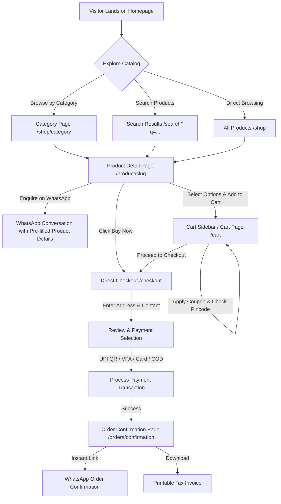
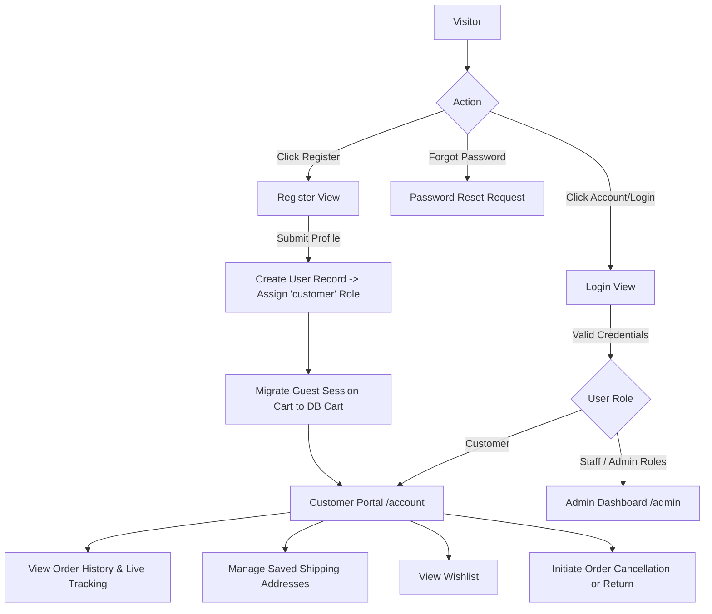
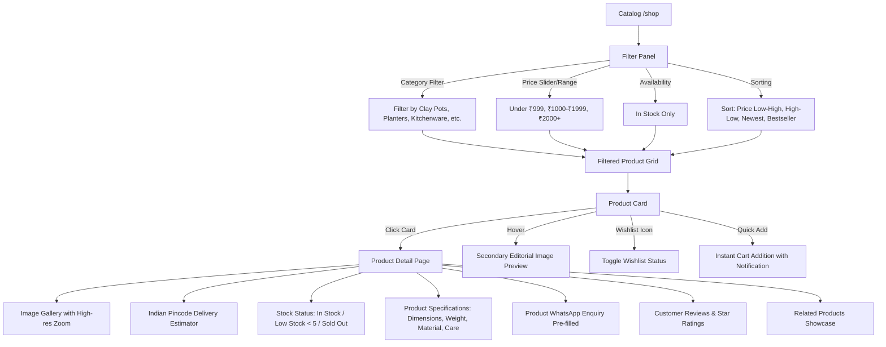
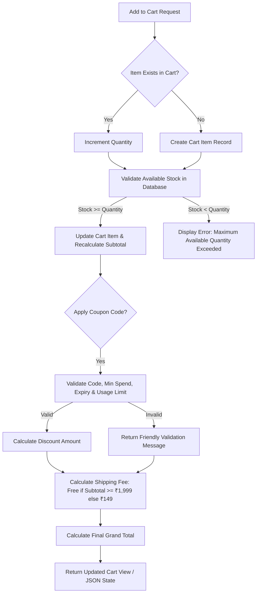
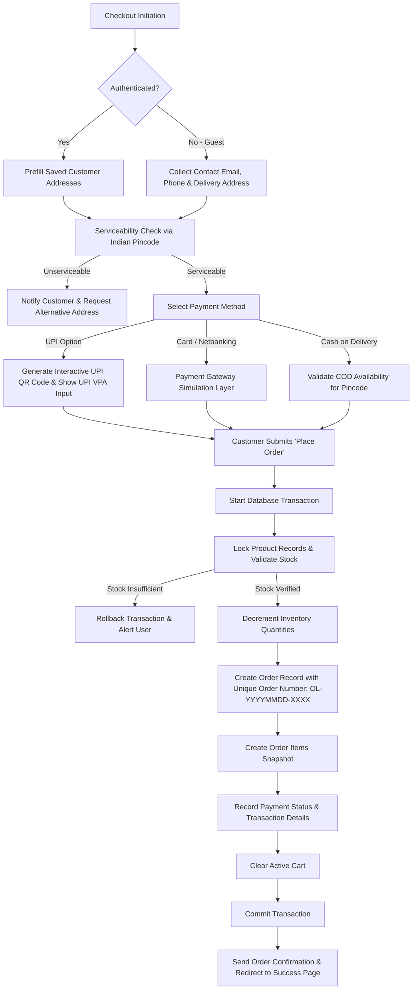
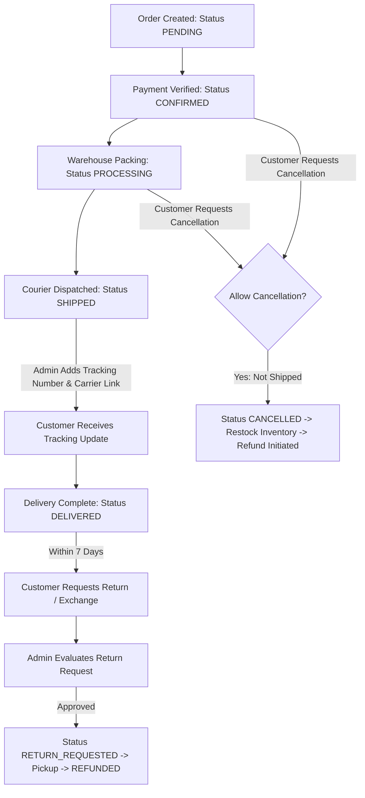
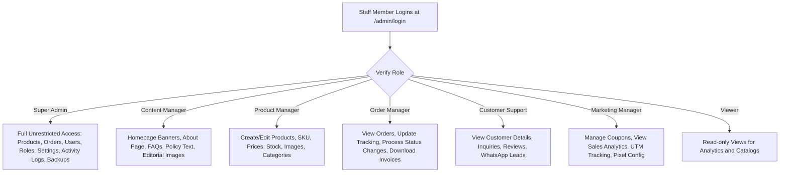

# Application Flows — Oreon Living

## 1. High-Level Customer Journey



---

## 2. Authentication & Account Flow



---

## 3. Product Discovery, Filtering & Detail Flow



---

## 4. Cart & Inventory Verification Flow



---

## 5. Checkout & Payment Flow (UPI / Card / COD)



---

## 6. Order Fulfillment & Post-Purchase Lifecycle



---

## 7. Role-Based Admin Operations Flow



---

## 8. Audit Trail & Price/Stock Change Logging

```mermaid
flowchart TD
    A[Staff Member Modifies Product / Price / Stock] --> B[Validate Request]
    B --> C[Fetch Original Values from Database]
    C --> D[Update Product Record]
    D --> E[Create ActivityLog Record]
    E -->|Capture| F[User ID, Role, Product Name, Old Price/Stock, New Price/Stock, Timestamp, IP]
    F --> G[Super Admin Activity Log Stream]
    
    note right of G
    Example Log Output:
    Product: Terracotta Water Pitcher
    Changed by: Product Manager (priya@oreon.com)
    Old price: ₹1,299
    New price: ₹1,099
    Date: 26 Aug 2026 16:30
    end
```
